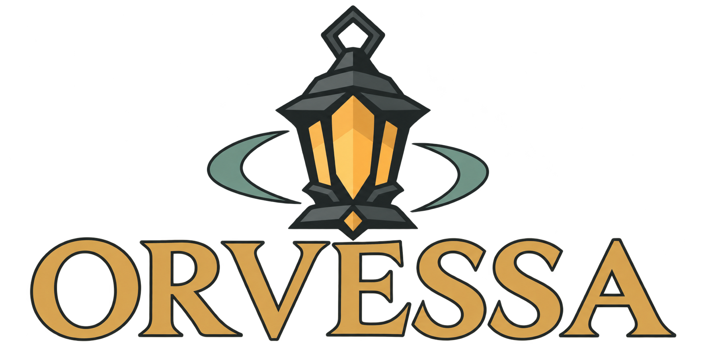

  

  <strong>RPG online em desenvolvimento para Roblox.</strong>

ORVESSA é um projeto de jogo de fantasia com foco em exploração, progressão do personagem e escolhas narrativas. Este repositório apresenta a proposta e o desenvolvimento do projeto para fins de portfólio.

> O jogo está na fase de fundação técnica. Os sistemas de jogabilidade descritos como objetivos ainda fazem parte do planejamento.

## Proposta

Criar uma experiência em que o jogador explore um mundo original, descubra caminhos e construa a identidade de seu personagem por meio de suas ações.

Os principais objetivos de design são:

- Exploração com descobertas e rotas que incentivem a curiosidade.
- Progressão de habilidades pelo uso, sem depender de classes fixas.
- Escolhas narrativas com consequências pessoais.
- Combate e controles pensados para diferentes dispositivos.
- Monetização planejada com foco em cosméticos, sem venda de poder.

O desenvolvimento prioriza um primeiro recorte jogável compacto antes da expansão do mundo e dos sistemas.

## Estado do desenvolvimento

A fase atual concentra-se na organização dos módulos e nas bases de dados e comunicação do jogo.

As frentes técnicas trabalhadas incluem:

| Frente | Objetivo |
| --- | --- |
| Configuração compartilhada | Centralizar parâmetros utilizados pelos sistemas |
| Modelo de perfil | Definir e validar a estrutura dos dados do jogador |
| Persistência | Integrar o ciclo de vida dos perfis ao servidor |
| Comunicação de rede | Definir solicitações permitidas e respostas do servidor |
| Validação e limites | Verificar dados recebidos e limitar a frequência de pedidos |

Essas frentes compõem a infraestrutura do projeto. Não representam um RPG completo, uma versão comercial ou sistemas de combate e quests já finalizados.

## Tecnologias

- **Roblox Studio** — criação e testes da experiência.
- **Luau** — implementação dos scripts e módulos.
- **ProfileStore** — gerenciamento de sessões de dados.
- **DataStore** — persistência.
- **RemoteEvents** — comunicação entre cliente e servidor.

## Abordagem técnica

O projeto utiliza uma organização modular, com separação entre responsabilidades do servidor e do cliente.

O servidor valida as solicitações recebidas e controla alterações nos dados do jogador. A comunicação procura enviar somente os campos necessários à interface. O desenvolvimento também considera tratamento de falhas, validação de perfis e distinção entre dados temporários de teste e dados persistentes.

Os scripts autorais utilizam tipagem estrita e comentários em português. A validação é realizada por etapas no Roblox Studio.

## Desafios de desenvolvimento

- Organizar uma base que permita acrescentar sistemas sem concentrar toda a lógica em um único script.
- Controlar o acesso ao perfil durante o carregamento e o encerramento da sessão.
- Definir contratos claros entre cliente e servidor.
- Tratar pedidos inválidos e excesso de solicitações.
- Manter o escopo inicial viável durante o desenvolvimento individual.

## Próximos marcos

- Concluir e validar a integração da fundação técnica.
- Construir o primeiro recorte jogável.
- Desenvolver os sistemas de jogabilidade de forma incremental.
- Avaliar controles, desempenho e experiência em diferentes dispositivos.
- Acrescentar imagens e vídeos conforme houver versões demonstráveis.

## Sobre este repositório

Este é um **repositório público de apresentação**. O código-fonte completo, o arquivo do projeto Roblox, o documento de design detalhado e os materiais internos de implementação não são disponibilizados nesta apresentação pública.

Não há uma versão jogável pública ou instruções de instalação disponibilizadas aqui neste momento.

## Autor

**Enzo Ramos de Almeida**  
[GitHub — ExKN1](https://github.com/ExKN1)

